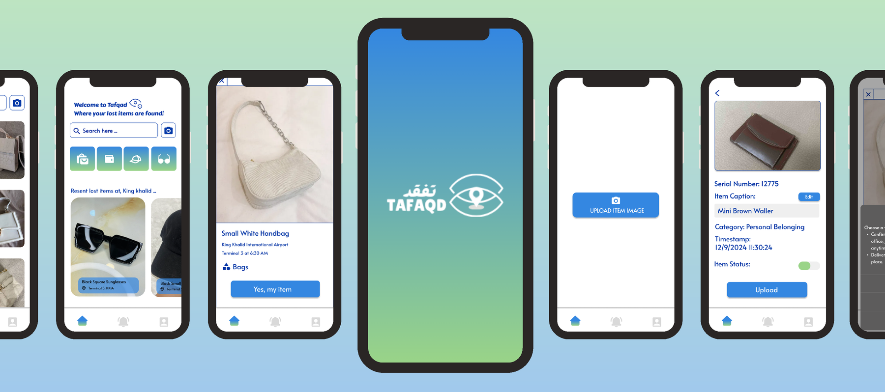
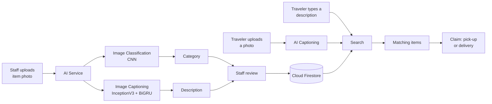
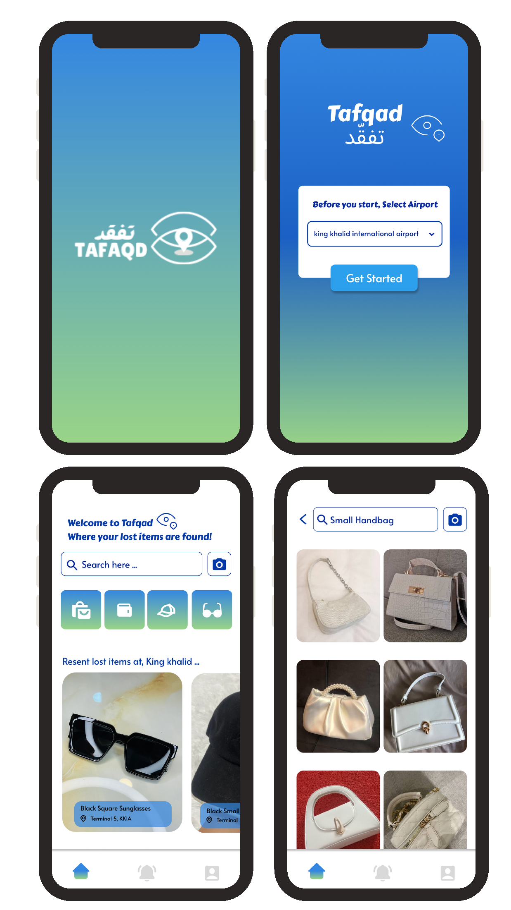
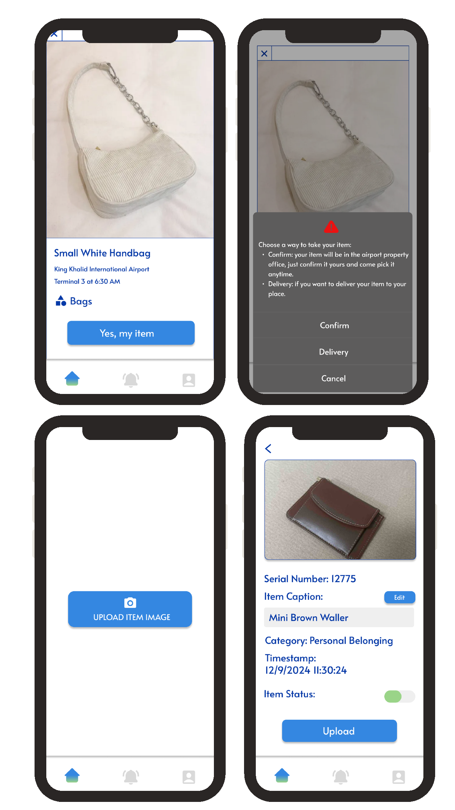

<p align="center">
  
</p>

<h1 align="center">Tafaqd | تفقّد</h1>

<p align="center">
  <strong>AI-Powered Lost and Found System</strong><br>
  Enhancing item retrieval efficiency through advanced image recognition and descriptive search
</p>

<p align="center">
  
  
  
  
</p>

---

## Overview

Every day, thousands of personal items are left behind in airports: bags, phones, wallets, chargers, keys. Recovering them still depends on manual logging, handwritten descriptions and phone calls. Staff spend hours cataloguing items, and travelers rarely find what they lost.

**Tafaqd** (Arabic for *"to check on"* or *"to look for"*) replaces this process with an intelligent platform. Staff photograph a found item, and the system recognizes it, classifies it and writes a description automatically. Travelers can then find their belongings by typing a description or by uploading a photo of the item, and request it for pick-up or delivery from a single mobile application.

## Key Results

<table>
  <tr>
    <td align="center" width="25%"><h2>85%</h2>Object detection accuracy</td>
    <td align="center" width="25%"><h2>91%</h2>Correct retrieval accuracy</td>
    <td align="center" width="25%"><h2>800+</h2>Labeled training images</td>
    <td align="center" width="25%"><h2>2</h2>Search modes: text and image</td>
  </tr>
</table>

- **85% object detection accuracy** in identifying and categorizing common lost items from photos.
- **91% correct retrieval accuracy** in returning the correct item to the traveler for a given search.
- Item registration moves from manual typing to a reviewed, AI-generated entry, which reduces staff effort and inconsistent descriptions.

## Features

### For travelers

- **Descriptive search:** find items with natural language, for example *"small white handbag"* or *"black charger"*.
- **Image-based search:** upload a photo of the lost item; the AI generates a caption and uses it to search.
- **Browse by category and airport:** view recently found items at a selected airport.
- **Claim and delivery:** confirm ownership, then choose to pick the item up or have it delivered.

### For airport staff

- **AI-assisted registration:** upload a photo and receive a predicted category and a generated description instantly.
- **Human in the loop:** review and edit AI output before saving, so every record stays accurate.
- **Item management:** track item status, serial numbers and timestamps, and manage claims from one dashboard.

## How It Works



1. **Capture:** staff photograph a found item.
2. **Understand:** a CNN classifier predicts the category and an encoder-decoder model generates a description.
3. **Verify:** staff confirm or correct the output, and the item is stored with its image, category, caption and location.
4. **Search:** travelers search by text or by photo, and photo searches are converted to captions by the same model.
5. **Recover:** the traveler claims the item and chooses pick-up or delivery.

## AI Models

| Model | Architecture | Purpose |
| --- | --- | --- |
| Image classification | Sequential CNN (Keras / TensorFlow) with dropout and softmax output | Predicts the item category |
| Image captioning | InceptionV3 encoder with an embedding and bidirectional GRU decoder | Generates a natural-language description |

The models were trained on a curated dataset of more than 800 images of items commonly lost in airports, drawn from COCO, Roboflow and Visual Genome and supplemented with manually collected images, using an 80/20 train/test split. Details are in [docs/ARCHITECTURE.md](docs/ARCHITECTURE.md).

## Technology Stack

| Area | Technologies |
| --- | --- |
| Mobile application | Flutter, Dart |
| Backend services | Firebase Authentication, Cloud Firestore, Firebase Cloud Messaging |
| Storage | Cloud object storage for item images |
| Artificial intelligence | Python, TensorFlow, Keras, InceptionV3, Jupyter Notebook |
| Design | Figma |
| Methodology | Agile software development |

## Interfaces

<p align="center">
  
</p>

<table>
  <tr>
    <td align="center"></td>
    <td align="center"></td>
  </tr>
  <tr>
    <td align="center"><sub>Onboarding, airport selection, home and search results</sub></td>
    <td align="center"><sub>Item details, claiming options, and staff item registration</sub></td>
  </tr>
</table>

## Repository Structure

```
tafaqd/
├── assets/            Banner, logo and interface screenshots
├── docs/
│   └── ARCHITECTURE.md   Components, request flows, AI models, dataset and data model
├── snippets/          Selected excerpts from the application source code
├── LICENSE
└── README.md
```

## Source Code

This repository presents the project, its design and its results. The complete source code, including the trained AI models and the full Flutter application, is kept private by the project team. Selected excerpts that illustrate the core workflows are available in [`snippets/`](snippets/).

For inquiries about the project, please contact the team.

## Future Work

- Pilot deployment in selected airports to measure performance in real operating conditions.
- Expansion to other high-traffic venues such as train stations, malls and stadiums.
- Multilingual support for international travelers.
- Integration with smart airport systems and IoT devices.
- Predictive analytics to anticipate common loss scenarios and improve recovery rates.

---

## Team

| Name |
| --- |
| Sumayah Chowdhury |
| Sara Al-Faifi |
| Layan Al-Mashhour |

<p align="center">
  <br>
  Graduation Project<br>
  <strong>College of Computer Science, King Khalid University</strong>
</p>

## License

Copyright (c) 2025 the Tafaqd team. All rights reserved. See [LICENSE](LICENSE) for details.
