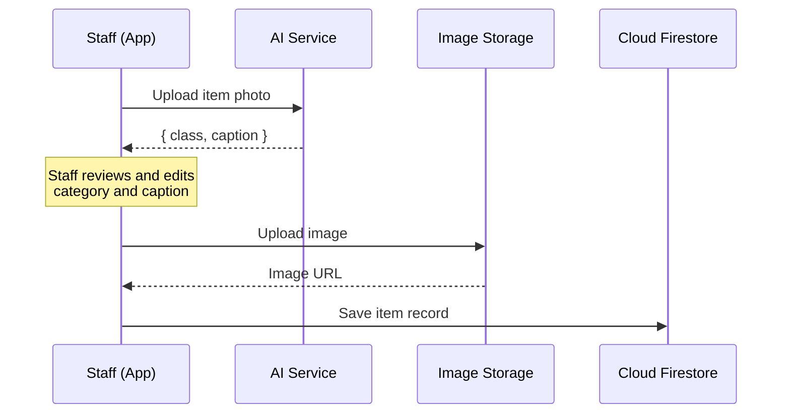
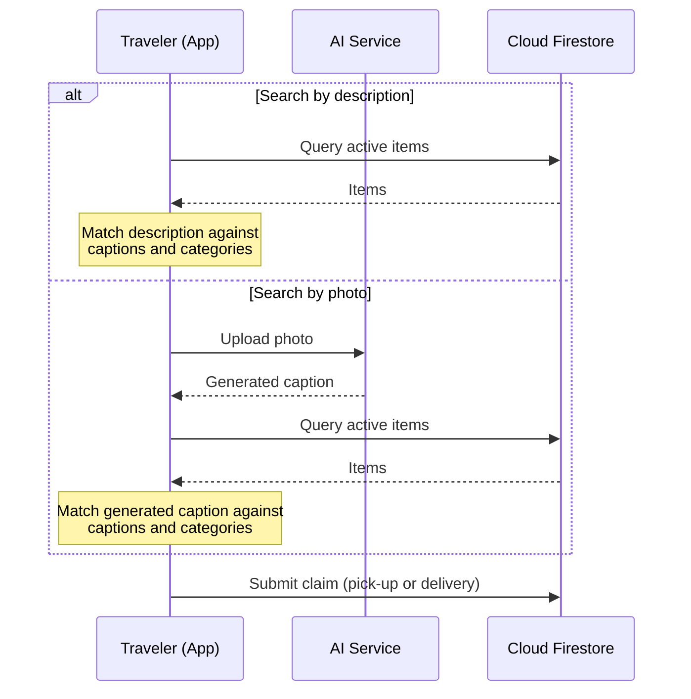

# System Architecture

This document gives a technical overview of Tafaqd: the system components, the AI models, the data, and how a request flows through the platform.

## 1. Components

| Layer | Technology | Responsibility |
| --- | --- | --- |
| Mobile application | Flutter (Dart) | Cross-platform app with separate traveler and staff interfaces |
| Authentication | Firebase Authentication | Account creation, sign-in and role-based access |
| Database | Cloud Firestore | Lost item records, captions, categories, claims and user data |
| Notifications | Firebase Cloud Messaging | Status updates for travelers and staff |
| Image storage | Cloud object storage | Original photos of registered items |
| AI service | Python, TensorFlow / Keras | Image classification and image captioning exposed through a REST endpoint |
| Design | Figma | Interface design and prototyping |

## 2. Request Flow

### Registering a found item (staff)

### Searching for a lost item (traveler)

## 3. AI Models

Tafaqd uses two complementary deep learning models.

### 3.1 Image classification

Assigns each photo to a predefined item category, such as bags, electronics or personal belongings.

- Sequential convolutional neural network (CNN) built with Keras and TensorFlow
- Convolution and pooling blocks followed by fully connected layers, with dropout to reduce overfitting
- ReLU activations in hidden layers and a softmax output layer
- Images resized and normalized, with data augmentation such as rotation and flipping
- Trained with the Adam optimizer and categorical cross-entropy loss

### 3.2 Image captioning

Generates a short natural-language description of the item, for example *"a purple suitcase with white dots pattern"*.

- **Encoder:** pre-trained InceptionV3 with the classification head removed, producing a 2048-dimensional feature vector per image
- **Decoder:** embedding layer followed by a bidirectional GRU; image features and text embeddings are concatenated, and a dense layer predicts the next word
- Captions tokenized and padded to a uniform length
- Trained with the Adam optimizer and categorical cross-entropy loss, using early stopping

The two models are modular. The predicted category is shown next to the generated caption and can serve as context for future caption improvements.

## 4. Dataset

| Property | Value |
| --- | --- |
| Sources | COCO, Roboflow, Visual Genome, and manually collected images |
| Size | 800+ labeled images |
| Split | 80% training / 20% testing |
| Annotation | Category and descriptive caption per image, with manual validation |

Sample entries:

| Image | Category | Caption |
| --- | --- | --- |
| `black_charger_lenovo.JPG` | Electronics | An old model black Lenovo charger |
| `Suitcase (14).jpg` | Bags | A purple suitcase with white dots pattern |
| `Car_Keys (15).jpg` | Other Personal Belongings | Black Lexus key fob in a black case with a leather key chain |

## 5. Data Model

Each registered item is stored in the `LostItems` collection:

| Field | Type | Description |
| --- | --- | --- |
| `serialNum` | string | Item serial number assigned by staff |
| `imageUrl` | string | Link to the stored photo |
| `desc` | string | AI-generated caption, reviewed by staff |
| `category` | string | AI-predicted category, reviewed by staff |
| `airport` | string | Airport where the item was found |
| `available` | bool | Whether the item is still available for claiming |
| `archived` | bool | Whether the item is closed or archived |
| `timestamp` | timestamp | Registration time |
| `userId` | string | Staff member who registered the item |
| `ownerId` | string | Traveler who claimed the item |

## 6. Engineering Process

The project followed an Agile methodology across six phases: planning, analysis, design, implementation, testing and integration, and evaluation. The design phase produced use case, sequence, activity, entity-relationship and context diagrams together with a high-fidelity Figma prototype. Testing covered unit tests of the AI model, the database queries and the UI components, followed by integration and functional testing based on real-world scenarios.
